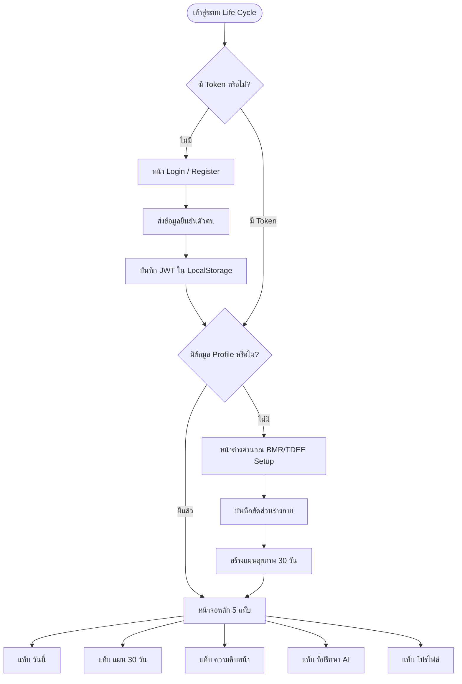
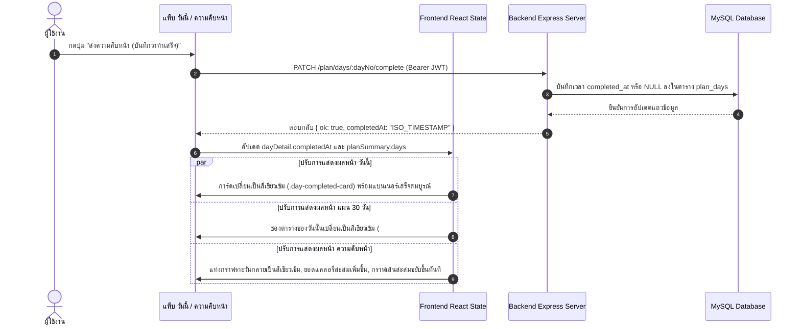

# โครงสร้างเว็บไซต์และสถาปัตยกรรมส่วนติดต่อผู้ใช้ Life Cycle (Web Structure & UI Architecture)

เอกสารโครงสร้างระบบเว็บและผังการทำงานของแอปพลิเคชัน **Life Cycle** สำหรับการนำเสนอ ตรวจทาน (Review) และพัฒนาต่อยอด

---

## 1. ภาพรวมสถาปัตยกรรมเว็บ (Web Architecture Overview)

แอปพลิเคชัน Life Cycle พัฒนาด้วยเทคโนโลยี Single Page Application (SPA) บนสถาปัตยกรรม Component-Driven และ Reactive State Synchronization:

- **Frontend Core**: React 18 + TypeScript + Vite
- **UI Framework & Styling**: Ionic React + Vanilla CSS Design System (ระบบกระจกฝ้า Glassmorphism บนธีมสีเขียวเข้ม Deep Dark Green)
- **Vector Visualizations**: Custom SVG Responsive Charts (กราฟแท่งรายวัน 30 วัน, กราฟเส้นสะสม, และภาพสาธิตท่าออกกำลังกาย 2 สเต็ป)
- **API Client**: RESTful JSON Fetch พร้อมการจัดการ JWT Authentication Token
- **การบังคับใช้กฎระเบียบ**: **ห้ามใช้ Emoji ในทุกหน้าจอและทุกข้อความโดยเด็ดขาด (Strict No-Emoji Constraint)**

---

## 2. ผังโครงสร้างหน้าจอและเส้นทางผู้ใช้ (Sitemap & Navigation Hierarchy)

```
[ จุดเริ่มต้น: Life Cycle App ]
  │
  ├── [ 1. หน้าต่างตรวจสอบสิทธิ์ (Authentication Gate) ]
  │     ├── เข้าสู่ระบบ (Sign In): Email + Password
  │     └── สมัครสมาชิก (Register): Name + Email + Password
  │
  ├── [ 2. หน้าต่างตั้งค่าร่างกายและเป้าหมาย (Profile Setup Wizard) ]
  │     ├── ข้อมูลกายภาพ: เพศ, อายุ, น้ำหนัก, ส่วนสูง
  │     ├── ระดับกิจกรรม: ไม่ออกกำลังกาย ถึง ออกกำลังกายหนักมาก (Activity Factor 1.2 - 1.9)
  │     ├── เป้าหมาย: ลดน้ำหนัก (-500 kcal), รักษาน้ำหนัก, เพิ่มกล้ามเนื้อ (+300 kcal)
  │     └── ช่วงเวลาว่างประจำวัน: สะดวกออกกำลังกายตอนเช้า หรือ ตอนเย็น
  │
  └── [ 3. แดชบอร์ดหลัก 5 แท็บ (Main Application Dashboard) ]
        │
        ├── แท็บที่ 1: วันนี้ (Today View)
        │     ├── สถานะของวัน และ ปุ่ม "ส่งความคืบหน้า (บันทึกว่าทำเสร็จ)"
        │     ├── แบนเนอร์วันที่เสร็จสมบูรณ์ (สีเขียวเข้ม Rich Dark Green)
        │     ├── สวิตช์สลับสถานที่ออกกำลังกาย: ที่บ้าน (บอดี้เวท) vs ที่ยิม (มีเครื่องมือ)
        │     ├── รายการท่าออกกำลังกาย พร้อมปุ่มดูภาพกราฟิกสาธิต 2 สเต็ป
        │     ├── แผนอาหาร 3-4 มื้อ พร้อมสัดส่วนโปรตีนและแคลอรี่
        │     └── ตารางเวลากิจวัตรประจำวัน (Schedule Timeline)
        │
        ├── แท็บที่ 2: แผน 30 วัน (30-Day Plan Grid)
        │     ├── แถบสรุปจำนวนวันที่ทำสำเร็จ (เช่น สำเร็จ 4/30 วัน)
        │     ├── ตารางปฏิทิน 30 วัน (30-Day Matrix)
        │     │     ├── วันที่ยังไม่ทำ: พื้นหลังกระจกโปร่งแสง
        │     │     ├── วันที่เลือกดู: ขอบไฮไลต์สว่าง
        │     │     └── วันที่บันทึกแล้ว: สีเขียวเข้มคมชัด (#14532d พร้อมขอบ #22c55e)
        │     └── ปุ่มคำนวณและสร้างแผนใหม่ทั้งหมด
        │
        ├── แท็บที่ 3: ความคืบหน้า (Progress & Analytics View)
        │     ├── การ์ดสถิติหลัก: ยอดแคลอรี่ที่เบิร์นสะสมรวม (XX,XXX kcal)
        │     ├── ตัวเลขเทียบเท่าไขมันที่ลดได้ (กรัม) และ Streak ความต่อเนื่อง
        │     ├── กราฟการเผาผลาญรายวัน (Interactive 30-Day SVG Bar Chart)
        │     ├── กราฟเส้นแนวโน้มสะสม (Cumulative Trend Area Chart)
        │     ├── แถบกรองข้อมูล: 30 วันทั้งหมด / เฉพาะวันที่ทำเสร็จ / 7 วันแรก
        │     ├── การ์ดตรวจสอบรายละเอียดวัน (Selected Day Inspector) + สลับสถานะได้ทันที
        │     └── บันทึกประวัติกิจกรรมย้อนหลัง (Chronological Completion Feed)
        │
        ├── แท็บที่ 4: ที่ปรึกษา AI (AI Health Coach)
        │     ├── ปุ่มลัดข้อความคำถามด่วน (Quick Suggestion Pills)
        │     ├── กล่องสนทนาโต้ตอบสด (Real-time Message Stream)
        │     └── แถบพิมพ์ข้อความปรึกษาด้านโภชนาการและการออกกำลังกาย
        │
        └── แท็บที่ 5: โปรไฟล์ (Profile & Energy Metrics)
              ├── สรุปค่าพลังงานเผาผลาญพื้นฐาน (BMR) ตามสูตร Mifflin-St Jeor
              ├── ค่าพลังงานรวมรายวัน (TDEE) และเป้าหมายแคลอรี่สุทธิ
              ├── สัดส่วนสารอาหารหลักและเพดานความปลอดภัย
              └── ปุ่มออกจากระบบ (Logout)
```

---

## 3. แผนภาพการทำงานและการไหลของข้อมูล (System Flowcharts)

### 3.1 ผังการนำทางของผู้ใช้งาน (User Journey & Navigation Flow)



### 3.2 ผังการซิงโครไนซ์สถานะเมื่อ "ส่งความคืบหน้า" (Progress Completion Reactive Flow)



---

## 4. โครงสร้างคอมโพเนนต์และการจัดเก็บไฟล์ (Component & File Hierarchy)

```
d:/Life_Cycle/lifeplan/frontend/src/
├── main.tsx                    # จุด Mount หลักของ React และ Ionic Framework
├── App.tsx                     # คอนโทรลเลอร์หลัก ควบคุม Auth, State, 5 แท็บ และ Modal
├── theme.css                   # ดีไซน์ซิสเต็ม กระจกฝ้า Glassmorphism และโทนสีเขียวเข้ม
│
├── components/
│   ├── ProgressView.tsx        # หน้าจอความคืบหน้า (กราฟแท่งรายวัน, กราฟสะสม, สถิติเผาผลาญ)
│   └── ExerciseVisual.tsx      # คอมโพเนนต์แสดงกราฟิกเวกเตอร์สาธิตท่า 2 สเต็ป (บ้าน vs ยิม)
│
└── lib/
    ├── api.ts                  # HTTP Fetch Client พร้อม JWT Header Injection
    └── types.ts                # TypeScript Interfaces สำหรับ User, Plan, Day, Workout
```

### รายละเอียดโครงสร้างคอมโพเนนต์ (Component Breakdown)

| คอมโพเนนต์ | หน้าที่หลัก | State และ Props สำคัญ |
| :--- | :--- | :--- |
| **App.tsx** | จัดการ Session ผู้ใช้, การสลับ 5 แท็บ, โหลดข้อมูลวัน, และควบคุม Modal | `token`, `activeTab`, `planSummary`, `dayDetail`, `exerciseMode`, `selectedExercise` |
| **ProgressView.tsx** | คำนวณยอดแคลอรี่สะสมรวม, แสดงผลกราฟแท่ง SVG 30 วัน, กราฟเส้นสะสม และประวัติย้อนหลัง | `days`, `targetDailyKcal`, `chartType`, `filterMode`, `selectedDayNo` |
| **ExerciseVisual.tsx** | วาด SVG การเคลื่อนไหวของร่างกาย 2 สเต็ป (Step 1 ท่าเริ่ม, Step 2 ท่าจบ) ครอบคลุมท่าบอดี้เวทและเครื่องยิม | `exerciseId`, `frame (0 หรือ 1)` |
| **theme.css** | กำหนด CSS Variables, Glassmorphism Backdrop Filter, สถานะสีเขียวเข้ม และความเข้ากันได้กับอุปกรณ์มือถือ | `--bg-deep`, `--sage`, `--glass-bg`, `.day-cell.completed`, `.day-completed-card` |

---

## 5. รายละเอียดฟังก์ชันของแต่ละหน้าจอ (Detailed Screen Specifications)

### 5.1 หน้าจอแท็บ "วันนี้" (Today Tab)
- **Header & สถานะ**: แสดงลำดับวันที่ปัจจุบัน (เช่น "วันที่ 3 จาก 30 วัน") และสถานะความคืบหน้า
- **แบนเนอร์สำเร็จ**: เมื่อบันทึกความคืบหน้าแล้ว จะแสดงแถบสีเขียวเข้มระบุ "ความคืบหน้าของวันนี้: บันทึกสำเร็จแล้ว"
- **ปุ่ม Action ส่งความคืบหน้า**:
  - ยังไม่ทำ: ปุ่มกดสีมาตรฐาน "ส่งความคืบหน้า (บันทึกว่าทำเสร็จ)"
  - ทำแล้ว: ปุ่มสีเขียวเข้มคมชัด "ทำเสร็จสิ้นแล้ว (แตะเพื่อยกเลิก)"
- **สวิตช์เลือกสถานที่ออกกำลังกาย (Workout Location Switcher)**:
  - สลับระหว่าง **"ออกกำลังกายที่บ้าน (บอดี้เวท)"** และ **"ออกกำลังกายที่ยิม (มีเครื่องมือ)"** ได้ตลอดเวลา
  - เมื่อสลับ โหมด ท่าออกกำลังกายจะเปลี่ยนตามทันทีโดยอัตโนมัติ
- **รายการท่าออกกำลังกาย**: แตะที่การ์ดเพื่อเปิด Modal ภาพสาธิต 2 สเต็ป พร้อมรายละเอียด เซ็ต, ครั้ง, เวลาพัก
- **รายการมื้ออาหาร**: แสดงชื่อเมนู, ปริมาณแคลอรี่, และปริมาณโปรตีนในแต่ละมื้อ
- **กิจวัตรประจำวัน (Timeline)**: แสดงไทม์ไลน์เวลาตื่นนอน, เวลารับประทานอาหาร, เวลาฝึกซ้อม และเวลานอน

### 5.2 หน้าจอแท็บ "แผน 30 วัน" (30-Day Plan Tab)
- **สรุปภาพรวม**: แถบแสดงจำนวนวันที่สำเร็จแล้ว เช่น "สำเร็จ 5/30 วัน"
- **ตาราง 30 วัน (30-Day Grid Matrix)**:
  - ช่องแสดงหมายเลขวันและแท็ก "พัก" หรือ "ฝึก"
  - วันที่กดส่งความคืบหน้าแล้วจะแสดงด้วย **สีเขียวเข้มคมชัด (#14532d ไล่เฉดไป #0c331b)** มีขอบสีเขียวมรกต 2px และตัวอักษรแท็กสีเขียวสว่าง (#86efac) เพื่อให้อ่านง่าย ชัดเจน ไม่กลืนกับพื้นหลัง
  - การแตะที่วันใดๆ จะโหลดข้อมูลของวันนั้นและสลับไปยังแท็บ "วันนี้" ทันที
- **ปุ่มสร้างแผนใหม่**: รองรับการจัดสรรตารางสุขภาพ 30 วันใหม่ทั้งหมดตามความต้องการ

### 5.3 หน้าจอแท็บ "ความคืบหน้า" (Progress View)
- **Hero Metric Card**:
  - ตัวเลขแคลอรี่รวมที่ถูกเบิร์นไปแล้ว (เช่น "1,280 kcal")
  - แถบความคืบหน้า % สู่เป้าหมาย 30 วัน
  - ตัวเลขประมาณการการลดไขมันสะสม (คำนวณจาก 7,700 kcal = ไขมัน 1 กก.)
  - ความต่อเนื่อง (Streak) และค่าเฉลี่ยแคลอรี่ต่อวันที่ออกกำลังกาย
- **กราฟการเผาผลาญรายวัน (Interactive SVG Daily Bar Chart)**:
  - แสดงแท่งกราฟของทั้ง 30 วัน (แกน X: วันที่, แกน Y: ปริมาณแคลอรี่ที่เบิร์น)
  - วันที่ทำเสร็จ: แท่งกราฟสีเขียวเข้มไล่เฉดมรกต (#22c55e -> #166534 -> #14532d) ขอบหนา 2.5px และมีจุด Glow Cap ประจำแท่ง
  - วันที่ยังไม่ทำ: แท่งกราฟโครงร่างโปร่งแสง
  - รองรับการแตะที่แท่งกราฟเพื่อดูรายละเอียดวันนั้นใน Inspector ด้านล่าง
- **กราฟเส้นแนวโน้มสะสม (Cumulative Trend Area Chart)**:
  - เส้นประสีเทา: เส้นสมมุติฐานเป้าหมายการเบิร์นตามแผน
  - เส้นทึบสีเขียวเข้ม + พื้นที่แรเงาสีเขียว: ผลการเบิร์นจริงที่ผู้ใช้กดส่งความคืบหน้า
- **แผงกรองข้อมูล**: กรองดู "30 วันทั้งหมด", "เฉพาะวันที่ทำเสร็จ", หรือ "7 วันแรก"
- **Day Inspector Card**: แสดงรายละเอียดของวันที่เลือก พร้อมปุ่มกดสลับสถานะทำเสร็จได้ทันที
- **บันทึกกิจกรรมย้อนหลัง (History Feed)**: แสดงการ์ดกิจกรรมของวันที่ทำสำเร็จย้อนหลังตามลำดับเวลา

### 5.4 หน้าจอแท็บ "ที่ปรึกษา AI" (AI Health Coach Tab)
- **ระบบแชตเพื่อสุขภาพแบบโต้ตอบ**: รองรับการสนทนากับ Gemini 3.5 Flash โดยมีระบบ Fallback ไปยังฐานข้อมูลออฟไลน์
- **ปุ่มคำถามสำเร็จรูป**: ช่วยให้ผู้ใช้กดถามคำถามยอดนิยมได้ด้วยการแตะเพียงครั้งเดียว
  - "แนะนำการคุมอาหารตามเป้าหมายของผม"
  - "ปรับตารางหากวันนี้ไม่มีเวลา"
  - "แนะนำท่ายืดเหยียดแก้อาการตึง"
- **ตัวกรอง Emoji**: ทุกข้อความตอบกลับจาก AI จะถูกผ่านกระบวนการลบ Emoji ออกก่อนแสดงผลบนหน้าจอ

### 5.5 หน้าจอแท็บ "โปรไฟล์" (Profile Tab)
- **ข้อมูลการเผาผลาญระดับบุคคล**:
  - BMR (Basal Metabolic Rate): อัตราเผาผลาญพื้นฐาน
  - TDEE (Total Daily Energy Expenditure): อัตราเผาผลาญรวมกิจกรรม
  - Target Calories: แคลอรี่เป้าหมายสุทธิต่อวัน
- **ข้อมูลร่างกายและเป้าหมาย**: เพศ, อายุ, น้ำหนัก, ส่วนสูง, ไลฟ์สไตล์, และเป้าหมาย
- **การออกจากระบบ**: ปุ่มล้าง Session และ Token เพื่อกลับสู่หน้าแรก

---

## 6. สเปกดีไซน์ซิสเต็มและชุดสี (Design System & Color Tokens)

ระบบดีไซน์ของ Life Cycle ใช้โครงสร้าง Glassmorphism ภายใต้บรรยากาศสีเขียวเข้มธรรมชาติที่ให้ความรู้สึกพรีเมียม สุขุม และอ่านง่าย:

```css
/* Color Tokens หลักใน theme.css */
--bg-deep: #0f1f18;             /* พื้นหลังระดับลึกสุด */
--bg-mid: #1c3a2c;              /* พื้นหลังระดับกลาง */
--bg-glow: #3d6b4f;             /* แสงเรืองระดับบน */
--sage: #a8c3a0;                /* สีเขียวเซจสำหรับข้อความเน้น */
--sage-strong: #c9dcb8;         /* สีเขียวเซจสว่างสำหรับหัวข้อ */
--text: #eaf1e4;                /* สีตัวอักษรหลัก (สีขาวนวล) */
--text-muted: rgba(234, 241, 228, 0.66); /* สีตัวอักษรคำอธิบาย */

/* สถานะวันที่บันทึกความคืบหน้าสำเร็จ (Completed Day Tokens) */
--completed-bg: linear-gradient(145deg, #14532d 0%, #0c331b 100%);
--completed-border: #22c55e;    /* สีเขียวมรกตคมชัด */
--completed-text-tag: #86efac;  /* สีเขียวสว่างสำหรับตัวหนังสือบนพื้นเขียวเข้ม */
--completed-pill: #14532d;      /* พื้นหลังสถานะพิลล์ */
```

---

## 7. ตารางจับคู่ RESTful API กับหน้าจอ (API Endpoint Mapping)

| Endpoint | HTTP Method | หน้าจอที่ใช้งาน | วัตถุประสงค์ |
| :--- | :--- | :--- | :--- |
| `/api/auth/register` | POST | หน้าตรวจสอบสิทธิ์ | สมัครสมาชิกใหม่และรับ JWT Token |
| `/api/auth/login` | POST | หน้าตรวจสอบสิทธิ์ | เข้าสู่ระบบและรับ JWT Token |
| `/api/profile` | GET / POST | หน้าตั้งค่า และ โปรไฟล์ | ดึงและบันทึกข้อมูลสัดส่วนร่างกายพร้อมคำนวณ BMR/TDEE |
| `/api/plan/current` | GET | วันนี้, แผน 30 วัน, ความคืบหน้า | ดึงสรุปแผน 30 วันและรายการสถานะวันที่ทำเสร็จ |
| `/api/plan/generate` | POST | หน้าตั้งค่า และ แผน 30 วัน | ประมวลผลสร้างแผน 30 วันใหม่แบบเต็มรูปแบบ |
| `/api/plan/days/:dayNo` | GET | วันนี้, แผน 30 วัน | ดึงข้อมูลมื้ออาหาร ตารางเวลา และท่าฝึกของวันนั้น |
| `/api/plan/days/:dayNo/complete` | PATCH | วันนี้, ความคืบหน้า | บันทึกหรือยกเลิกการทำเสร็จของวันนั้น (ซิงค์สถานะทันที) |
| `/api/chat/history` | GET | ที่ปรึกษา AI | ดึงประวัติการสนทนาย้อนหลัง |
| `/api/chat` | POST | ที่ปรึกษา AI | ส่งข้อความถาม AI พร้อมรับคำแนะนำสุขภาพ |

---

## 8. รายการตรวจสอบความถูกต้องก่อนส่งมอบ (Review Checklist)

- [x] **ชื่อแอปพลิเคชัน**: ใช้ชื่อ **Life Cycle** ถูกต้องทุกจุด
- [x] **ข้อกำหนดเรื่อง Emoji**: ปราศจาก Emoji ใน UI, โค้ด, กราฟ, แผนที่ และเอกสารโดยสิ้นเชิง
- [x] **การแสดงผลวันที่ทำเสร็จ**: เปลี่ยนจากสีจางเป็นสีเขียวเข้มคมชัด (#14532d / #22c55e) สังเกตเห็นได้ง่ายและมีคอนทราสต์สูง
- [x] **ความลื่นไหลแบบ Reactive**: เมื่อกดส่งความคืบหน้าในหน้าใด สถานะจะเปลี่ยนพร้อมกันทั้ง 3 หน้า (วันนี้, แผน 30 วัน, ความคืบหน้า) ทันที
- [x] **โหมดสถานที่ออกกำลังกาย**: สลับระหว่างที่บ้าน (บอดี้เวท) และที่ยิม (เครื่องมือ) ได้ตลอดเวลาพร้อมเปลี่ยนท่าฝึกทันที
- [x] **ภาพสาธิตท่าออกกำลังกาย**: แสดงผลกราฟิกเวกเตอร์ 2 สเต็ปอย่างครบถ้วนสำหรับทุกท่าฝึก
